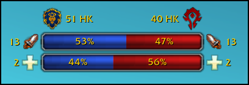

# BattleGroundBalance
**BattleGroundBalance** is a World of Warcraft addon for **Wrath of the Lich King (WotLK) 3.3.5a**  

## Features  
- Shows proportional bars of total damage and healing done by each faction, to help visualize overall BG balance. 
- Displays the number of damagers and healers per faction (requires [BattleGroundHealers](https://github.com/KhalGH/BattleGroundHealers-WotLK/)).
- Shows the highest honorable kills reached by a player in each faction, as a representative value for the team.

  

## Chat Commands  
- **`/bgb lock`** &nbsp; &nbsp; &nbsp; &nbsp; &nbsp; &nbsp; &nbsp; → Toggles frame lock/unlock.
- **`/bgb scale <#>`** &nbsp; &nbsp;&nbsp; → Sets frame scale (0.5 to 2).
- **`/bgb width <#>`** &nbsp;&nbsp; &nbsp; → Sets bar width (150 to 500).
- **`/bgb height <#>`** &nbsp; &nbsp; → Sets bar height (20 to 100).
- **`/bgb iconSize <#>`** → Sets icon size (25 to 100).
- **`/bgb fontSize <#>`** → Sets font size (10 to 50).  
- **`/bgb reset`** &nbsp; &nbsp; &nbsp; &nbsp; &nbsp; &nbsp; → Reset all settings to default.  

## Installation  
1. [Download](https://github.com/KhalGH/BattleGroundBalance-WotLK/releases/download/v1.1.0/BattleGroundBalance-v1.1.0.zip) the addon
2. Extract the **BattleGroundBalance** folder into `World of Warcraft/Interface/AddOns/`.  
3. Restart the game and enable the addon.  

## Information  
- **Addon Version:** 1.1.0  
- **Game Version:** 3.3.5a (WotLK)  
- **Author:** Khal  
